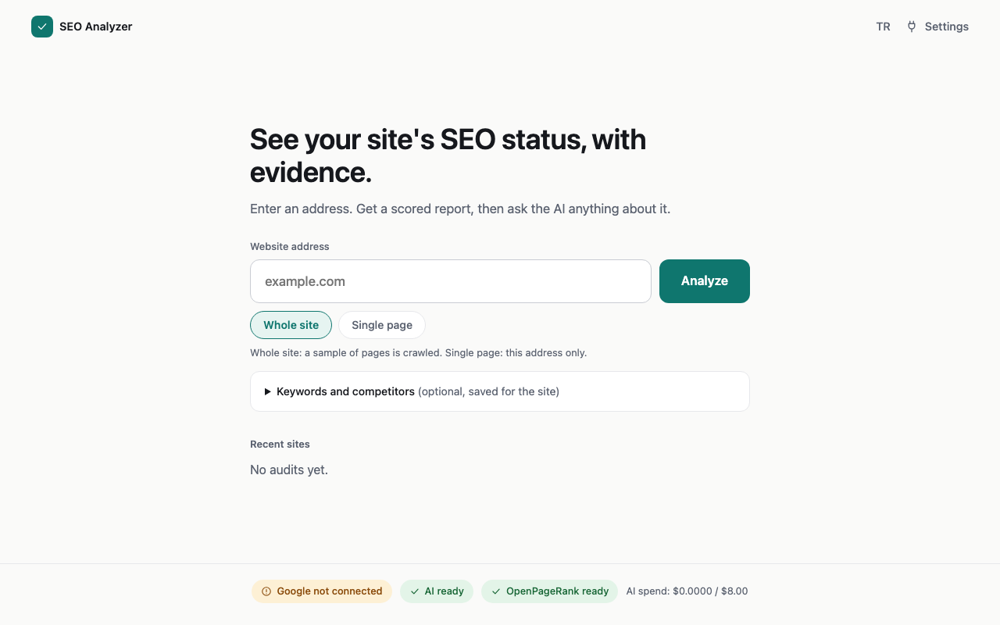
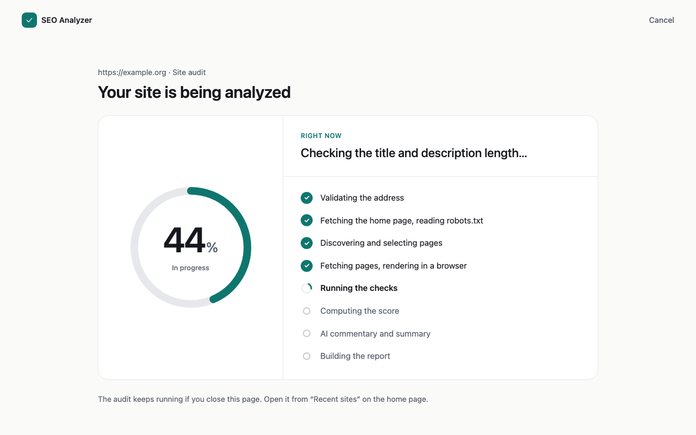
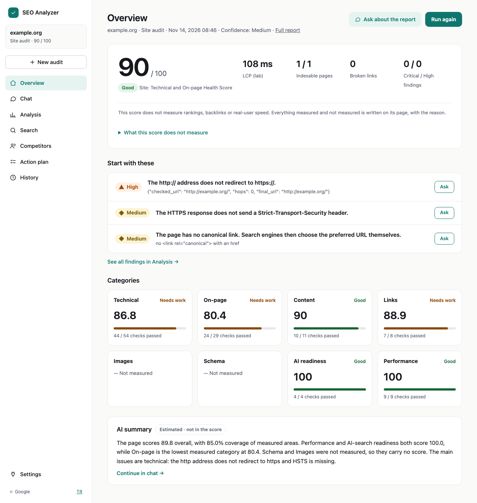
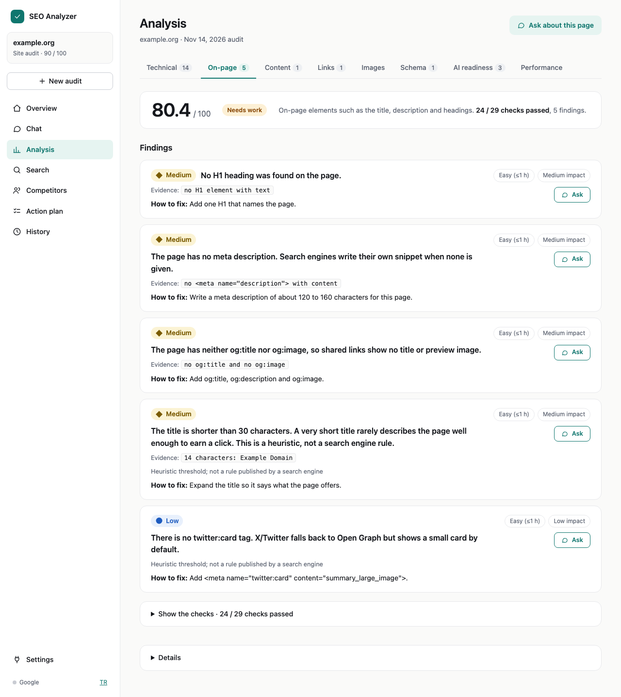
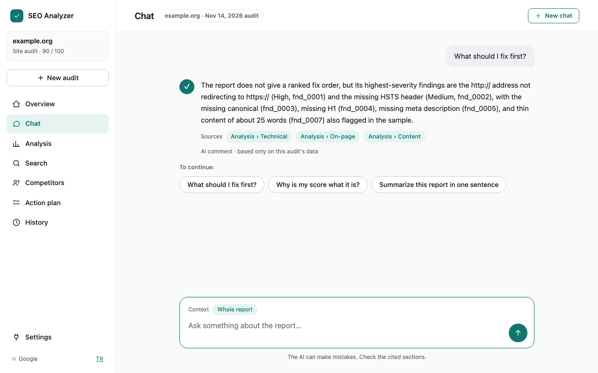
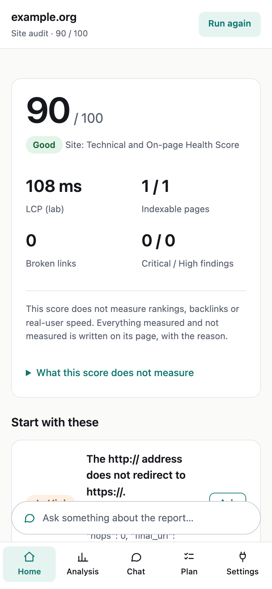

<div align="center">

# SEO Analyzer

Scored, evidence-backed SEO audits with an AI chat. Deterministic checks decide the score; the AI never does.

[Changelog](CHANGELOG.md) · [License](LICENSE) · [Notice](NOTICE) · [Architecture](docs/development.md) · [Configuration](docs/configuration.md) · [Google setup](docs/google-setup.md) · [Contributing](CONTRIBUTING.md) · [Security](SECURITY.md) · [Türkçe](README.tr.md)

</div>

---

## Install

Requires **Python 3.11 or newer** and Git.

```bash
git clone https://github.com/Arslanex/seo-analyzer.git
cd seo-analyzer

python3 -m venv .venv
source .venv/bin/activate              # Windows: .venv\Scripts\activate
pip install -e '.[dev]'
python -m playwright install chromium  # for JavaScript rendering and screenshots (once)

cp .env.example .env                   # optional: add keys (see docs/configuration.md)
```

## Use

> Designed for a single user on `localhost`. There is no authentication; do not expose it to the internet.

```bash
python scripts/run_server.py          # http://127.0.0.1:8000
```

Type an address in the browser, pick **Whole site** or **Single page** and press **Analyze**. Progress streams live; when it finishes, the app opens with a left menu:

| Page | What it shows |
|---|---|
| Overview | Score, what to look at first, 8 categories, AI summary |
| Chat | Ask about the report; answers cite their sources |
| Analysis | Category tabs, findings, evidence and how to fix them |
| Search | Search Console, rankings, indexability, visibility signals |
| Competitors | Competitor comparison, domain authority, local SEO |
| Action plan | Fixes grouped into phases, and quick wins |
| History | Difference from the previous audit |
| Settings | Status and tests of each connection |

A printable single-page report: `/audits/<id>/report`.

### Command line and API

```bash
python scripts/run_audit.py https://example.com --mode page --html report.html

curl -s -X POST localhost:8000/v1/audits -H 'content-type: application/json' \
     -d '{"url": "example.com", "mode": "page"}'          # 202 + {"id": ...}
curl -s localhost:8000/v1/audits/<id>/report              # audit.json
curl -s localhost:8000/v1/spend                           # AI spending
```

## Screenshots

Real output for an audit of `example.org` (site mode, light theme). Speed numbers are lab data from the machine that ran the audit.

**Home**: type an address, pick whole site or a single page.



**Progress**: the counter and ring follow the real pipeline stages; the line at the top says what is being done right now.



**Overview**: the score, what to look at first, and the eight categories.



**Analysis**: one tab per category, with evidence and how to fix each finding.



**Chat**: answers come only from this audit's data, and the chips link to the cited sections.



**Mobile**: the menu moves to a bottom bar and the chat box stays within reach.


