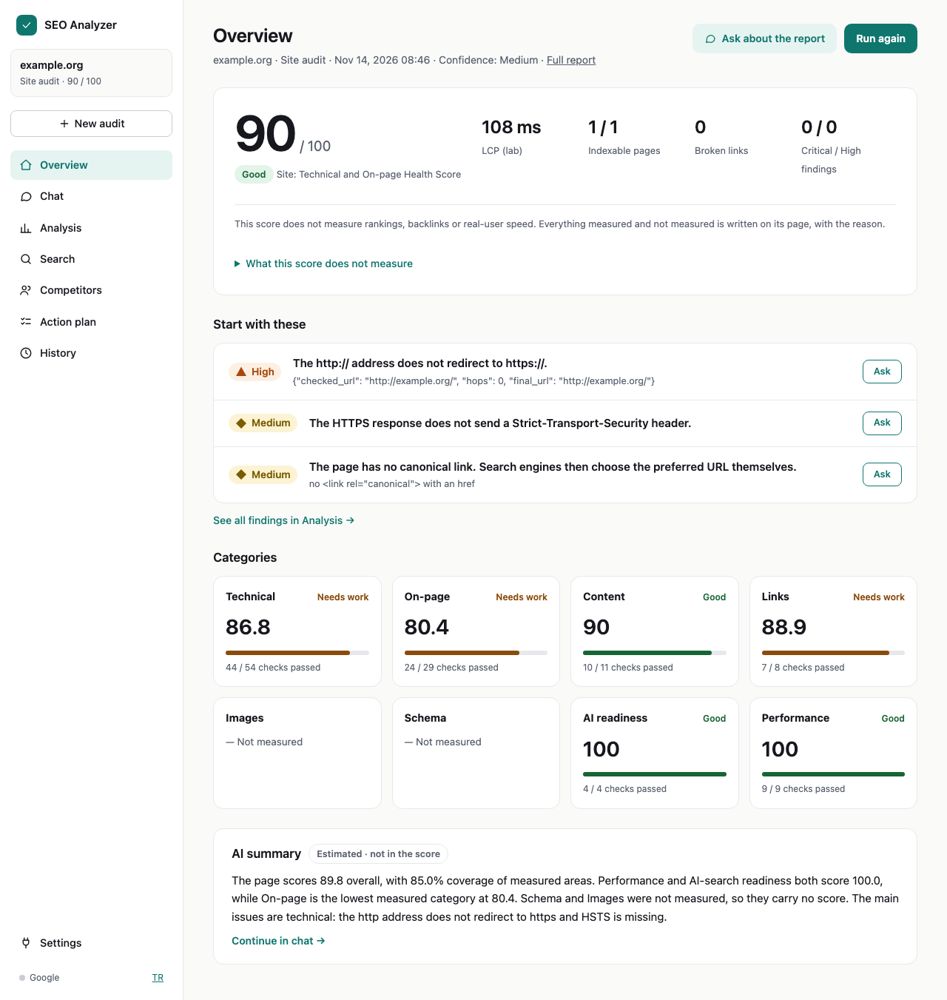

# seoa: SEO analizi

[English](README.md) · **Türkçe**

Bir web sitesi adresi girin, **skorlu ve kanıtlı** bir SEO raporu alın, sonra raporla ilgili istediğinizi yapay zekâya sorun.

Skoru deterministik kontroller belirler. Yapay zekâ yalnızca yorum, öneri ve soru-cevap ekler; skora girmez. Rapor, neyi ölçtüğünü ve neyi ölçmediğini nedeniyle birlikte yazar.

- **Teknik ve sayfa içi kontroller:** başlık, açıklama, canonical, schema, robots.txt, sitemap, TLS ve güvenlik başlıkları, JavaScript render farkı, yapay zekâ tarayıcılarının erişimi.
- **Site analizi:** kırık ve yönlenen bağlantılar, yetim sayfalar, lab hız ölçümü (LCP, CLS, FCP), görseller, indekslenebilirlik, kopya içerik.
- **Google verisi (isteğe bağlı):** Search Console (indeksleme, sorgular, sıralama), CrUX saha verisi, PageSpeed.
- **Sohbet:** yapay zekâ yalnızca bu denetimin verisine dayanır ve kaynak gösterir.
- **Geçmiş:** aynı sitenin denetimlerini karşılaştırır. Anahtar kelimeler ve rakipler site başına kaydedilir.

> Tek kullanıcılı ve yalnızca `localhost` için tasarlandı. Kimlik doğrulaması yoktur; internete açmayın.

## Kurulum

Gerekenler: **Python 3.11 veya üstü** ve Git.

```bash
git clone https://github.com/Arslanex/seo-analyzer.git
cd seo-analyzer

python3 -m venv .venv
source .venv/bin/activate              # Windows: .venv\Scripts\activate
pip install -e '.[dev]'
python -m playwright install chromium  # JavaScript render ve ekran görüntüsü için (bir kez)

cp .env.example .env                   # isteğe bağlı: anahtarları ekleyin (docs/configuration.tr.md)
```

## Kullanım

```bash
python scripts/run_server.py          # http://127.0.0.1:8000
```

Tarayıcıda adresi yazın, **Tüm site** veya **Tek sayfa** seçin ve **Analiz et**'e basın. İlerleme canlı akar; bitince sol menülü uygulama açılır:

| Sayfa | İçerik |
|---|---|
| Genel bakış | Skor, önce bakılacak bulgular, 8 kategori, yapay zekâ özeti |
| Sohbet | Rapora soru sorun; cevaplar kaynak gösterir |
| Analiz | Kategori sekmeleri, bulgular, kanıt ve nasıl düzeltileceği |
| Arama | Search Console, sıralama, indekslenebilirlik, görünürlük sinyalleri |
| Rakipler | Rakip karşılaştırması, alan adı otoritesi, yerel SEO |
| Eylem planı | Fazlara ayrılmış düzeltmeler ve hızlı kazançlar |
| Geçmiş | Önceki denetimle fark |
| Ayarlar | Bağlantıların durumu ve testleri |

Yazdırmaya uygun tek sayfalık rapor: `/audits/<id>/report`.

### Komut satırı ve API

```bash
python scripts/run_audit.py https://example.com --mode page --html rapor.html

curl -s -X POST localhost:8000/v1/audits -H 'content-type: application/json' \
     -d '{"url": "example.com", "mode": "page"}'          # 202 + {"id": ...}
curl -s localhost:8000/v1/audits/<id>/report              # audit.json
curl -s localhost:8000/v1/spend                           # yapay zekâ harcaması
```

## Daha fazla belge

- [Yapılandırma](docs/configuration.tr.md): tüm ayarlar ve Google bağlantısı
- [Google kurulumu](docs/google-setup.tr.md): Search Console adım adım
- [Geliştirme ve mimari](docs/development.tr.md): kod yerleşimi, testler, nasıl genişletilir
- [Güvenlik ve sınırlar](docs/security-and-limits.tr.md): nelerin korunduğu, nelerin korunmadığı
- [Kararlar](docs/adr/README.md): mimari karar kayıtları (İngilizce)

[Değişiklik günlüğü](CHANGELOG.md) · [Katkı](CONTRIBUTING.md) · [Güvenlik politikası](SECURITY.md) · Lisans: [MIT](LICENSE) (atıf için [NOTICE](NOTICE))

## Ekran görüntüleri

`example.org` denetiminden gerçek çıktılar (site modu, açık tema). Hız değerleri, denetimi çalıştıran makineden alınan lab verisidir.

**Ana sayfa**: adresi yazın, tüm site veya tek sayfa seçin.


**İlerleme**: sayaç ve çember gerçek iş hattı adımlarını izler; üstteki satır şu an ne yapıldığını söyler.


**Genel bakış**: skor, önce bakılacaklar ve sekiz kategori.



**Analiz**: her kategori için bir sekme; bulgunun kanıtı ve nasıl düzeltileceği.


**Sohbet**: cevaplar yalnızca bu denetimin verisinden gelir; çipler atıf yapılan bölümlere gider.


**Mobil**: menü alt çubuğa iner, sohbet kutusu elinizin altında kalır.


