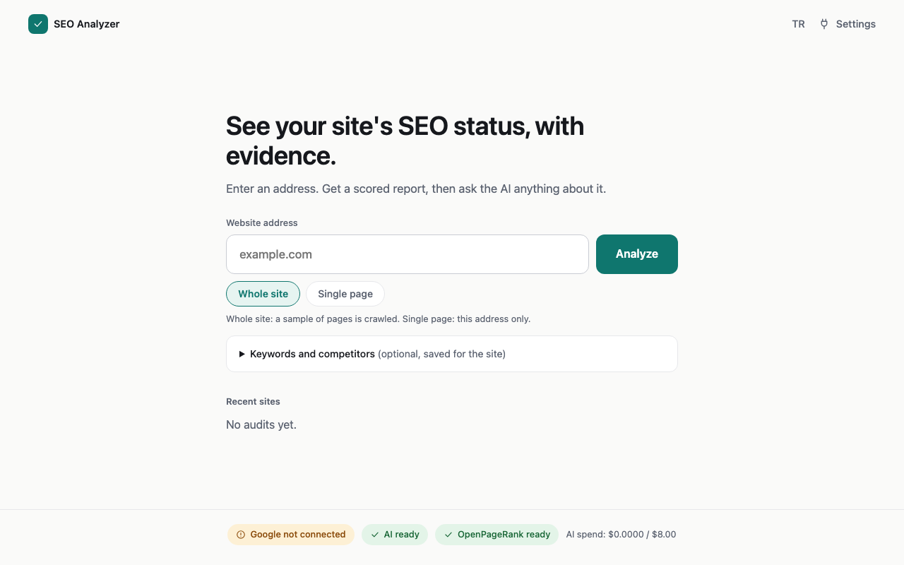
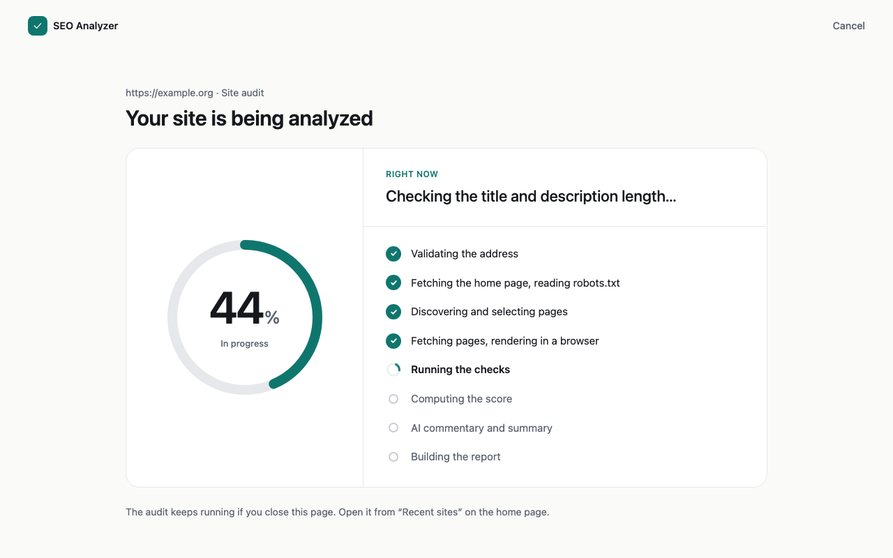
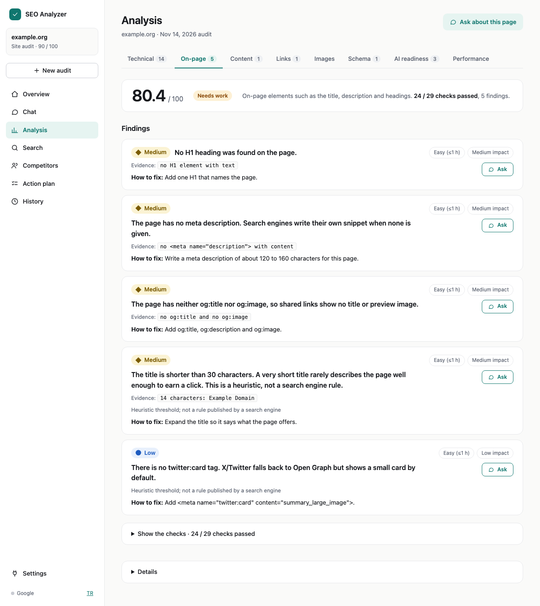
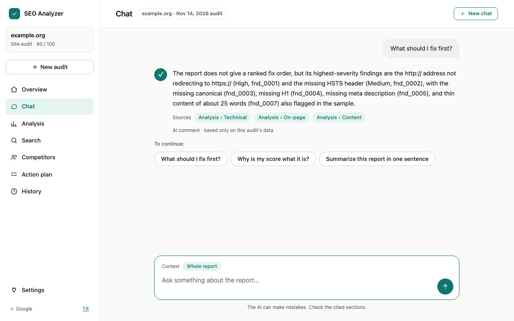
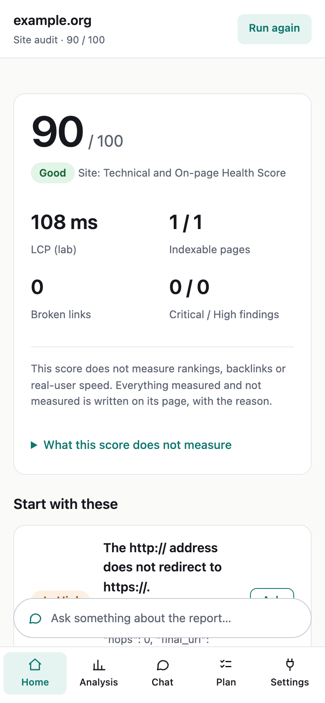

# seoa: SEO analizi

[English](README.md) · **Türkçe**

Bir web sitesi adresi girin, **skorlu ve kanıtlı** bir SEO raporu alın, sonra raporla ilgili istediğinizi yapay zekâya sorun.

Skoru deterministik kontroller belirler. Yapay zekâ yalnızca yorum, öneri ve soru-cevap ekler; skora girmez. Rapor, neyi ölçtüğünü ve neyi ölçmediğini nedeniyle birlikte yazar.

- **Teknik ve sayfa içi kontroller:** başlık, açıklama, canonical, schema, robots.txt, sitemap, TLS ve güvenlik başlıkları, JavaScript render farkı, yapay zekâ tarayıcılarının erişimi.
- **Site analizi:** kırık ve yönlenen bağlantılar, yetim sayfalar, lab hız ölçümü (LCP, CLS, FCP), görseller, indekslenebilirlik, kopya içerik.
- **Google verisi (isteğe bağlı):** Search Console (indeksleme, sorgular, sıralama), CrUX saha verisi, PageSpeed.
- **Sohbet:** yapay zekâ yalnızca bu denetimin verisine dayanır ve kaynak gösterir.
- **Geçmiş:** aynı sitenin denetimlerini karşılaştırır. Anahtar kelimeler ve rakipler site başına kaydedilir.

> Tek kullanıcılı ve yalnızca `localhost` için tasarlandı. Kimlik doğrulaması yoktur; internete açmayın.

## Ekran görüntüleri

`example.org` denetiminden gerçek çıktılar (site modu, açık tema). Hız değerleri, denetimi çalıştıran makineden alınan lab verisidir.

**Ana sayfa**: adresi yazın, tüm site veya tek sayfa seçin.



**İlerleme**: sayaç ve çember gerçek iş hattı adımlarını izler; üstteki satır şu an ne yapıldığını söyler.



**Genel bakış**: skor, önce bakılacaklar ve sekiz kategori.


**Analiz**: her kategori için bir sekme; bulgunun kanıtı ve nasıl düzeltileceği.



**Sohbet**: cevaplar yalnızca bu denetimin verisinden gelir; çipler atıf yapılan bölümlere gider.



**Mobil**: menü alt çubuğa iner, sohbet kutusu elinizin altında kalır.



## Kurulum

Gerekenler: **Python 3.11 veya üstü** ve Git.

```bash
git clone https://github.com/Arslanex/seo-analyzer.git
cd seo-analyzer

python3 -m venv .venv
source .venv/bin/activate              # Windows: .venv\Scripts\activate
pip install -e '.[dev]'
python -m playwright install chromium  # JavaScript render ve ekran görüntüsü için (bir kez)

cp .env.example .env                   # sonra .env dosyasını doldurun (aşağıya bakın)
```

## Yapılandırma (`.env`)

Hiçbiri zorunlu değildir. Hangisi eksikse yalnızca ilgili bölüm "ölçülmedi" der ve nedenini yazar. Hangi bağlantının hazır olduğunu uygulamada **Ayarlar › Bağlantılar** sayfasından görür ve **Test et** düğmesiyle sınarsınız.

| Değişken | Ne işe yarar | Nereden alınır |
|---|---|---|
| `ANTHROPIC_API_KEY` | Özet, öneriler, E-E-A-T yorumu ve **Sohbet** | [console.anthropic.com](https://console.anthropic.com/) |
| `SEOA_GOOGLE_API_KEY` | Gerçek kullanıcı hız verisi (CrUX) ve PageSpeed | Google Cloud › Credentials › API key (aşağıya bakın) |
| `SEOA_OPENPAGERANK_KEY` | Alan adı otoritesi tahmini | [keywordseverywhere.com/account/openpagerank](https://keywordseverywhere.com/account/openpagerank) (ücretsiz anahtar tek bir IP'ye bağlıdır) |
| `SEOA_LLM_MODEL` | Kullanılan model (varsayılan `claude-haiku-5-5`) | |
| `SEOA_LLM_BUDGET_USD` | Bu kurulumun toplam yapay zekâ harcama tavanı (varsayılan 8) | |
| `SEOA_MAX_PAGES` | Site denetiminde örneklem sayfa sayısı (varsayılan 25) | |
| `SEOA_RENDER` | `0` yazarsanız tarayıcıyla render kapanır | |
| `SEOA_DATA_DIR` | Veritabanı ve dosyaların yeri (varsayılan `./data`) | |

`.env` ve `data/` klasörü `.gitignore` içindedir; anahtarlarınız ve Google belirteçleriniz depoya girmez.

### Google bağlantısı

İki ayrı şey vardır:

1. **Tek bir API anahtarı** (CrUX ve PageSpeed için, site sahipliği gerekmez): Google Cloud'da bir proje açın, *Chrome UX Report API* ve *PageSpeed Insights API*'yi etkinleştirin, **Credentials › Create credentials › API key** ile anahtar üretin, iki API ile kısıtlayın ve `SEOA_GOOGLE_API_KEY` olarak `.env`'e yazın.
2. **Search Console** (kendi siteniz için indeksleme, sorgular, sıralama): salt okunur OAuth ile bağlanır.
   1. Aynı projede *Google Search Console API*'yi etkinleştirin.
   2. OAuth onay ekranını **External / Testing** olarak kurun ve kendi e-postanızı *Test users* listesine ekleyin.
   3. **Desktop app** türünde bir OAuth istemcisi oluşturup JSON'u `data/google_client.json` olarak kaydedin.
   4. Uygulamayı başlatın, **Ayarlar › Bağlantılar › Google ile bağlan** düğmesine basın.
   5. Sitenin hesabınızda doğrulanmış bir Search Console mülkü olmalıdır (en kolayı *Alan* mülkü).

Ayrıntılar ve sık görülen hatalar: [`docs/google-setup.tr.md`](docs/google-setup.tr.md). Durumu komut satırından görmek için: `python scripts/google_setup_check.py`.

## Kullanım

```bash
python scripts/run_server.py          # http://127.0.0.1:8000
```

Tarayıcıda adresi yazın, **Tüm site** veya **Tek sayfa** seçin ve **Analiz et**'e basın. İlerleme canlı akar; bitince sol menülü uygulama açılır:

| Sayfa | İçerik |
|---|---|
| Genel bakış | Skor, önce bakılacak bulgular, 8 kategori, yapay zekâ özeti |
| Sohbet | Rapora soru sorun; cevaplar kaynak gösterir |
| Analiz | Kategori sekmeleri, bulgular, kanıt ve nasıl düzeltileceği |
| Arama | Search Console, sıralama, indekslenebilirlik, görünürlük sinyalleri |
| Rakipler | Rakip karşılaştırması, alan adı otoritesi, yerel SEO |
| Eylem planı | Fazlara ayrılmış düzeltmeler ve hızlı kazançlar |
| Geçmiş | Önceki denetimle fark |
| Ayarlar | Bağlantıların durumu ve testleri |

Yazdırmaya uygun tek sayfalık rapor: `/audits/<id>/report`.

### Komut satırı ve API

```bash
python scripts/run_audit.py https://example.com --mode page --html rapor.html

curl -s -X POST localhost:8000/v1/audits -H 'content-type: application/json' \
     -d '{"url": "example.com", "mode": "page"}'          # 202 + {"id": ...}
curl -s localhost:8000/v1/audits/<id>/report              # audit.json
curl -s localhost:8000/v1/spend                           # yapay zekâ harcaması
```

## Mimari

Kod dört katmana ayrılmıştır. **Bağımlılıklar yalnızca içe doğru akar**: iç katman, dıştakini bilmez.

```
presentation  ─▶  infrastructure  ─▶  application  ─▶  domain
 (HTTP, HTML)     (SQLite, HTTP,      (kullanım         (saf iş
                   tarayıcı, LLM,      senaryoları,      kuralları,
                   Google)             portlar)          modeller)
```

```
src/seoa/
├── config.py            ortam ayarları (.env)
├── bootstrap.py         bileşim kökü: somut sınıfları burada bağlar
├── domain/              saf iş kuralları, G/Ç yok
│   ├── models.py        varlıklar ve değer nesneleri
│   ├── rules/           kural kataloğu ve saf sayfa/schema kontrolleri
│   ├── scoring/         skor hesabı
│   ├── parsing/         HTML -> ParsedPage
│   ├── i18n/            Türkçe ve İngilizce metinler
│   └── urls.py, url_safety.py, text.py, ...
├── application/         kullanım senaryoları
│   ├── ports.py         dış dünyadan beklenenler (Protocol)
│   ├── audit/           iş hattı (orchestrator), servis, DTO'lar
│   ├── analysis/        links/, performance/, search_console/, modules/
│   ├── crawl/           keşif, örneklem, sitemap
│   ├── site/            robots.txt ve yapay zekâ tarayıcı erişimi
│   └── reporting/       AuditRecord -> AuditReport
├── infrastructure/      dış dünya
│   ├── http/            SSRF korumalı istemci, DNS çözücü, TLS/başlık sondaları
│   ├── persistence/     SQLite
│   ├── llm/             istemci, bütçe defteri, ajanlar, istemler
│   ├── integrations/    Google, CrUX, PSI, OpenPageRank, RDAP, Wayback ...
│   ├── rendering/       başsız tarayıcı
│   └── adapters.py      iş hattının dışarıya baktığı tek yüzey
└── presentation/
    ├── api/             FastAPI: routers/ (audits, reports, meta, home, audit_pages, settings)
    └── web/             Jinja şablonları, stiller, küçük betik
```

Kurallar `tests/architecture` ile otomatik denetlenir: katman yönü, import döngüsü yokluğu, `domain`'in hiçbir dış katmanı bilmemesi. Kararların gerekçesi: [`docs/adr/0001-layered-architecture.md`](docs/adr/0001-layered-architecture.md). Ürün tasarımı belgeleri: [`docs/architecture/`](docs/architecture/README.md).

**Yeni bir analiz modülü eklemek:** `application/analysis/modules/` altına bir dosya koyun, `register_module(...)` ile kaydedin ve `plugin.py` içindeki `MODULE_FILES` listesine adını ekleyin. Rapor bölümü `application/reporting/` altında okunur.

## Geliştirme

```bash
pytest -q                    # tüm testler (ağ ve yapay zekâ gerektirmez)
pytest tests/architecture    # katman kuralları
ruff check src tests scripts && ruff format --check src tests scripts
mypy                         # strict
```

Testler katmanları yansıtır: `tests/unit/{domain,application,infrastructure,presentation}`, uçtan uca `tests/e2e`.

Yapay zekâ ajanlarını gerçek API ile (yaklaşık 0,006 dolar) tek tek sınamak için: `python scripts/test_agents.py --agent all --budget 1`.

## Güvenlik ve gizlilik

- Kullanıcı adresleri tek bir istemciden geçer: özel IP, loopback ve metadata adresleri reddedilir; her yönlendirme ve render isteği doğrulanır.
- Anahtarlar yalnızca `.env` içinde durur; günlüklere, raporlara ve hata mesajlarına yazılmaz. Ayarlar sayfası anahtarı geri göstermez, yalnızca tanımlı olup olmadığını söyler.
- Güvenlik açığı bildirimi için [`SECURITY.md`](SECURITY.md).

## Sınırlar

Tek kullanıcı, kimlik doğrulama yok, süreç içi kuyruk ve SQLite. Performans **lab** ölçümüdür (bu makineden); gerçek kullanıcı verisi için CrUX anahtarı gerekir, yeni ve az trafikli sitelerde Google veri vermez. Geri bağlantı verisi yoktur. Bilinen sınırların tam listesi [`CHANGELOG.md`](CHANGELOG.md) içinde.

## Katkı ve lisans

Katkı için [`CONTRIBUTING.md`](CONTRIBUTING.md). Lisans: [MIT](LICENSE). Bazı parçalar MIT lisanslı [claude-seo](https://github.com/AgriciDaniel/claude-seo) projesinden türetilmiştir; atıf [`NOTICE`](NOTICE) dosyasındadır.
